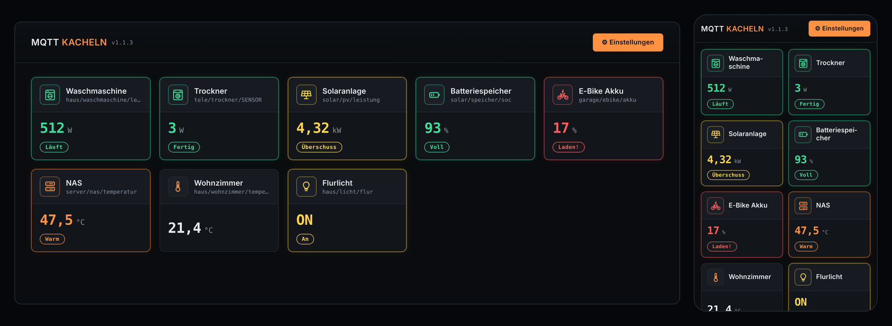

# MQTT-Kachel-Dashboard-MK1

Lokales Web-Dashboard, das Werte aus **MQTT-Topics als Kacheln** anzeigt – im
dunklen, technischen Design des Drucker Dashboards MK6. Ein einziges
Python-Skript (`app.py`), **keine Zusatzpakete**, keine Cloud.

**Version: 1.3.0**



| Plattform | Lieferform | Entsteht in |
|---|---|---|
| Windows | `MQTT-Kachel-Dashboard.exe` | GitHub Actions |
| macOS (Apple Silicon) | `MQTT-Kachel-Dashboard.app` | GitHub Actions |
| GL.iNet Brume 2 | Offline-Installationspaket `…-brume2-offline.tar.gz` | GitHub Actions |
| beliebig mit Python ≥ 3.7 | `python3 app.py` | – |

## Funktionen

- MQTT-Broker auf der Webseite eintragen (Host, Port, Benutzer/Passwort, optional TLS),
  mit **„Verbindung testen“** und Verbindungsstatus in den Einstellungen.
- Alle empfangenen Topics werden mitgelesen (Filter einstellbar, Standard `#`) und
  stehen im **Topic-Browser** bzw. in der **Topic-Suche** der Kachel zur Auswahl.
- Jede Kachel zeigt den Wert eines Topics mit
  - frei wählbarer **Einheit** (W, °C, %, kWh …),
  - **Symbol** aus 42 Logos (Waschmaschine, Trockner, Spülmaschine, Server, E-Fahrrad,
    Solaranlage, Lampe, Steckdose, Batterie, Wallbox, Heizung, Wärmepumpe …),
  - optional **JSON-Feld** (z. B. `ENERGY.Power` bei Tasmota) – per Klick aus dem
    aktuellen Inhalt wählbar,
  - **Nachkommastellen** und **Faktor** (z. B. 0,001 für W → kW),
  - beliebig vielen **Schwellwerten**: *erreicht / überschreitet / unterschreitet /
    ist gleich / ungleich / Text enthält* → Text in wählbarer Farbe auf der Kachel
    (Kachelrahmen, Symbol und Wert färben sich mit).
- **Weitere Topics je Kachel:** z. B. neben der Leistung zusätzlich den Schaltzustand
  (`stat/steckdose/POWER`) – angezeigt werden die Texte der zutreffenden Bedingungen,
  etwa „Eingeschaltet“ / „Ausgeschaltet“.
- **Aktion beim Antippen:** je Kachel ein Topic + Payload (z. B. `cmnd/steckdose/POWER` /
  `TOGGLE`), optional mit Rückfrage und als „retained“. Kacheln mit Aktion tragen ein
  kleines Blitz-Symbol.
- Ein kleiner **Punkt oben rechts** auf jeder Kachel wechselt bei jeder neuen MQTT-Nachricht
  des Topics zwischen Grün und Hintergrundfarbe – auch wenn der Wert gleich bleibt.
- Kacheln stehen **nebeneinander**: auf Rechner und iPad richtet sich die Anzahl
  nach der Fensterbreite, auf dem iPhone sind es immer genau zwei.
- **iPhone-tauglich**: große Werte, keine Zoom-Sprünge in
  Eingabefeldern, „Zum Home-Bildschirm“ mit eigenem App-Symbol.
- **Port der Webseite dauerhaft änderbar** – der Server zieht sofort um, die Seite
  leitet automatisch weiter (auf dem Brume wird die Firewall-Regel mitgezogen).
- Alle Einstellungen in **`config.json` neben der exe/App** (gut lesbares JSON).

---

## 1. Build & Release per GitHub Actions

1. Neues GitHub-Repository anlegen (z. B. `MQTT-Kachel-Dashboard-MK1`).
2. **Den kompletten Inhalt dieses Ordners** hochladen – inklusive des versteckten
   Ordners `.github/` sowie `.gitattributes`.
3. Unter **Actions** startet „Build & Release“ automatisch (oder manuell über
   *Run workflow*). Nach ca. 5–10 Minuten liegt unter **Releases → v1.1.0**:
   - `MQTT-Kachel-Dashboard-v1.1.0-windows.zip`
   - `MQTT-Kachel-Dashboard-v1.1.0-macos-arm64.zip`
   - `MQTT-Kachel-Dashboard-v1.1.0-brume2-offline.tar.gz`
4. Für eine neue Version `APP_VERSION` oben in `app.py` erhöhen und pushen – es
   entsteht automatisch ein neues Release.

Sollte der Release-Schritt mit „403 Resource not accessible“ abbrechen: Unter
*Settings → Actions → General → Workflow permissions* „Read and write permissions“
wählen (der Workflow fordert die Rechte zwar selbst an, manche Organisationen
sperren das aber).

## 2. Windows

Zip entpacken, `MQTT-Kachel-Dashboard.exe` in einen **eigenen Ordner** legen und
starten. Beim ersten Start entsteht daneben die `config.json`, der Browser öffnet
sich automatisch.

- **SmartScreen** („Der Computer wurde durch Windows geschützt“): *Weitere
  Informationen → Trotzdem ausführen* (die exe ist nicht signiert).
- Die **Windows-Firewall** fragt einmalig nach Netzwerkzugriff – für „Private
  Netzwerke“ erlauben, sonst ist die Seite vom iPhone aus nicht erreichbar.
- Beenden: Konsolenfenster schließen oder *Einstellungen → Programm beenden*.

## 3. macOS

Zip entpacken und `MQTT-Kachel-Dashboard.app` **in einen eigenen Ordner**
verschieben (z. B. `~/MQTT-Kachel-Dashboard/`). Die `config.json` liegt dann
direkt neben der App.

- Die App ist nicht notarisiert. Beim ersten Start: Rechtsklick → *Öffnen* →
  *Öffnen*, oder im Terminal:
  `xattr -dr com.apple.quarantine ~/MQTT-Kachel-Dashboard/MQTT-Kachel-Dashboard.app`
- Die App läuft **im Hintergrund ohne Dock-Symbol** und öffnet den Browser.
  Beenden über *Einstellungen → Programm beenden*.
- Wird die App direkt aus „Downloads“ gestartet, verschiebt macOS sie u. U. in einen
  schreibgeschützten Zufallsordner; die Konfiguration landet dann ersatzweise in
  `~/MQTT-Kachel-Dashboard-MK1/config.json` (Pfad steht unter *Einstellungen → Info*).
- Gebaut für Apple Silicon (M1–M4). Auf Intel-Macs `python3 app.py` verwenden.

## 4. GL.iNet Brume 2 – Zip kopieren und installieren (ohne GitHub)

```
scp MQTT-Kachel-Dashboard-MK1-v1.3.0.zip root@<BRUME-IP>:/tmp/
ssh root@<BRUME-IP>
cd /tmp && unzip -o MQTT-Kachel-Dashboard-MK1-v1.3.0.zip
sh MQTT-Kachel-Dashboard-MK1/install.sh
```

`install.sh` erledigt den Rest: Python3 installieren falls nötig (online per opkg),
Programm nach `/root/MQTT-Kachel-Dashboard-MK1/` kopieren, Autostart und
Firewall-Regel einrichten, starten. Optionen: `--port=8086`, `--ohne-firewall`.
Update = neue Zip genauso entpacken und `install.sh` erneut starten.

## 4b. GL.iNet Brume 2 (Offline-Paket aus dem GitHub-Release)

Der Brume 2 braucht **kein Internet** – das Paket enthält alle Python3-Pakete
(.ipk für OpenWrt 21.02 / aarch64_cortex-a53).

```
scp MQTT-Kachel-Dashboard-v1.1.0-brume2-offline.tar.gz root@<BRUME-IP>:/tmp/
ssh root@<BRUME-IP>
cd /tmp && tar xzf MQTT-Kachel-Dashboard-v1.1.0-brume2-offline.tar.gz
cd MQTT-Kachel-Dashboard-brume2 && sh install.sh
```

(Bei neuerem OpenSSH ggf. `scp -O …`.)

Der Installer
- installiert Python3 nur, falls es noch fehlt (vorhandenes Python bleibt unangetastet),
- kopiert das Programm nach `/root/MQTT-Kachel-Dashboard-MK1/`,
- richtet den **Autostart** ein (`/etc/init.d/mqtt-kachel-dashboard`, procd, startet
  bei Absturz neu),
- gibt den Port in der **Firewall auch für die WAN-Seite** frei (abschaltbar mit
  `--ohne-firewall`),
- zeigt am Ende die Adressen an.

Optionen: `--port=8086` (nur beim ersten Installieren), `--ohne-firewall`.
**Update:** neueres Paket genauso entpacken und `sh install.sh` erneut starten –
`config.json` bleibt erhalten. **Deinstallation:**
`sh /root/MQTT-Kachel-Dashboard-MK1/uninstall.sh` (mit `--alles` inkl. Konfiguration).
Log: `logread | grep python`.

Das Offline-Paket kann auch ohne GitHub auf einem eigenen PC mit Internet gebaut
werden: `brume2/offline-paket-bauen-windows.bat` bzw.
`brume2/offline-paket-bauen-mac.command` (Python 3 nötig) → Ergebnis in `dist/`.

## 5. Bedienung

1. **Einstellungen → MQTT-Broker**: Host/IP und Port eintragen, ggf. Benutzer und
   Passwort, *Verbindung testen*, dann *Speichern & verbinden*.
2. **Kachel anlegen**: *+ Kachel hinzufügen* (oder im Topic-Browser bei einem Topic
   *+ Kachel*). Topic eintippen – passende Topics mit aktuellem Wert erscheinen zur
   Auswahl. Ist der Inhalt JSON, das gewünschte Feld anklicken.
3. Einheit, Symbol und Schwellwerte festlegen; die **Vorschau** zeigt live, wie die
   Kachel aussieht.
4. Mit den Pfeilen in der Kachelliste die Reihenfolge ändern.

**Beispiel Waschmaschine** (Leistung in W über eine Messsteckdose), Modus *Nur ersten Treffer*:

| Bedingung | Wert | Text | Farbe |
|---|---|---|---|
| erreicht oder überschreitet | 1500 | Heizt | Orange |
| erreicht oder überschreitet | 5 | Läuft | Grün |
| unterschreitet | 5 | Aus | Grau |

Für Text-Werte (z. B. `ON`/`OFF`) *ist gleich* bzw. *Text enthält* verwenden
(Groß-/Kleinschreibung egal). Verglichen wird der **angezeigte** Wert, also nach
Faktor.

**iPhone:** Seite in Safari öffnen → Teilen → *Zum Home-Bildschirm*.

**Port ändern:** *Einstellungen → Webseite → Port* → *Speichern*. Die Seite springt
automatisch auf den neuen Port. Ist der Port belegt, erscheint eine Meldung und der
alte bleibt aktiv. Ist der gespeicherte Port beim Programmstart belegt, weicht das
Programm vorübergehend auf den nächsten freien Port aus (steht im Konsolenfenster).

## 6. Die Datei `config.json`

Liegt neben exe/App/`app.py` und kann (bei beendetem Programm) mit jedem Editor
bearbeitet werden. Ist sie fehlerhaft, wird sie als `config.json.defekt-<Datum>`
gesichert und das Programm startet mit Standardwerten.

```json
{
  "server": { "port": 8085, "host": "0.0.0.0", "titel": "MQTT Kacheln", "browser_oeffnen": true },
  "broker": {
    "host": "192.168.1.10", "port": 1883, "benutzer": "", "passwort": "",
    "tls": false, "tls_zertifikat_nicht_pruefen": false,
    "client_id": "kachel-ab12cd", "topic_filter": "#", "keepalive": 30
  },
  "kacheln": [
    {
      "id": "k1a2b3c4d", "name": "Trockner", "topic": "tele/trockner/SENSOR",
      "json_feld": "ENERGY.Power", "einheit": "W", "nachkommastellen": 0, "faktor": 1.0,
      "symbol": "trockner", "treffer_modus": "alle",
      "schwellwerte": [ { "vergleich": ">", "wert": "100", "text": "Trocknet", "farbe": "orange" } ],
      "zusatz_topics": [
        { "topic": "stat/trockner/POWER", "json_feld": "", "treffer_modus": "erster",
          "schwellwerte": [ { "vergleich": "==", "wert": "ON", "text": "Eingeschaltet", "farbe": "gruen" },
                            { "vergleich": "==", "wert": "OFF", "text": "Ausgeschaltet", "farbe": "grau" } ] }
      ],
      "klick_topic": "cmnd/trockner/POWER", "klick_payload": "TOGGLE",
      "klick_retain": false, "klick_bestaetigen": true
    }
  ]
}
```

- `vergleich`: `>=`, `>`, `<=`, `<`, `==`, `!=`, `enthaelt`
- `farbe`: `gruen`, `orange`, `rot`, `blau`, `gelb`, `lila`, `grau`
- `nachkommastellen`: `-1` = automatisch
- Das Passwort steht im Klartext in der Datei – `config.json` daher nicht weitergeben
  (ist per `.gitignore` vom Repo ausgeschlossen).

## 7. Hinweise

- Die **Client-ID** muss pro Programm-Instanz eindeutig sein. Laufen zwei Instanzen
  mit derselben Client-ID am selben Broker, werfen sie sich gegenseitig raus.
- Bei sehr großen Brokern (tausende Topics, Kamerabilder) den **Topic-Filter**
  einschränken, z. B. `haus/#`. Kachel-Topics werden immer zusätzlich abonniert.
- Die Webseite hat **keinen Passwortschutz** – nur im eigenen Netz betreiben.
- Unterstützt MQTT 3.1.1 über TCP und TLS (kein WebSocket).

## Dateien

```
docs/vorschau.png               Vorschaubild für die README
install.sh                      Installation auf dem Brume 2 (startet brume2/install.sh)
app.py                          Programm (Server, MQTT-Client, Webseite)
requirements.txt                nur für den Build (PyInstaller)
assets/icon.ico|icns|png        Programmsymbole
.github/workflows/build.yml     Build & Release (exe, Mac-App, Brume-Paket)
.gitattributes                  hält Zeilenenden der Shell-Skripte korrekt
brume2/build_offline_paket.py   baut das Offline-Paket inkl. Python3-.ipk
brume2/install.sh               Installer auf dem Brume 2
brume2/uninstall.sh             Deinstallation
brume2/LIESMICH-BRUME2.txt      Kurzanleitung im Paket
brume2/offline-paket-bauen-*    Offline-Paket lokal bauen (Windows/Mac)
```

## Versionen

- **1.3.0** – Weitere Topics je Kachel mit eigenen Bedingungen/Texten (z. B. Ein/Aus-Anzeige);
  Aktion beim Antippen einer Kachel (Topic + Payload, optional Rückfrage/retained).
- **1.2.0** – Nachrichten-Punkt auf jeder Kachel (wechselt bei jeder neuen MQTT-Nachricht
  zwischen Grün und Hintergrundfarbe).
- **1.1.3** – Installer erkennt belegten Port auf dem Brume und weicht automatisch aus,
  wartet bis zu 20 s auf den Start, zeigt bei Fehlern die Log-Meldungen; Modulprüfung
  vollständig; IP-Anzeige repariert.
- **1.1.2** – `install.sh` im Hauptordner: Zip per scp auf den Brume kopieren, entpacken,
  `sh install.sh` – fertig. Installer holt fehlendes Python3 online per opkg.
- **1.1.0** – Standard-Port 8085; Kachelgrößen-Umschalter S/M/L entfernt (iPhone immer
  zwei Kacheln nebeneinander, sonst nach Fensterbreite); Broker-Status nicht mehr auf der
  Kachel-Ansicht; Symbol „E-Fahrrad“; Zeitangabe („gerade eben“) auf den Kacheln entfernt.
- **1.0.0** – Erste Version: Kacheln mit Topic, JSON-Feld, Einheit, Faktor, Symbol und
  Schwellwert-Texten; Topic-Browser; Port per Webseite änderbar; exe/Mac-App/Brume-2-
  Offline-Paket per GitHub Actions.
